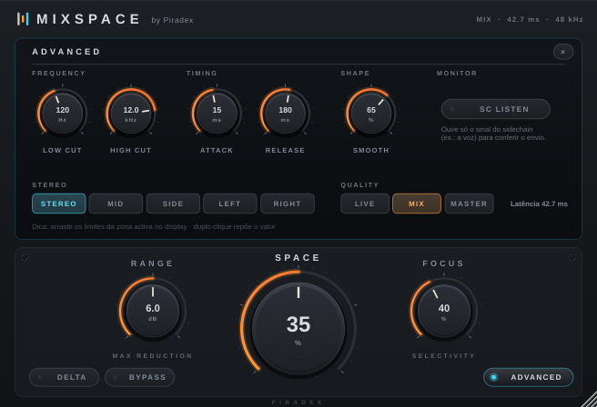

# MIXSPACE by Piradex

**Spectral sidechain para VST3 / AU (macOS e Windows).**
Insira no beat, envie a voz para o sidechain, rode **SPACE**. O MIXSPACE retira do instrumental só as frequências que estão realmente a colidir com a voz — o resto do beat fica cheio.

> "Não baixar o instrumental. Retirar apenas aquilo que está no caminho."


## Página principal — 3 knobs

| Controlo | O que faz |
|---|---|
| **SPACE** (0–100 %) | *Quanto* o plugin reage: com que facilidade a colisão se transforma em redução. Zona mais musical: 15–35 %. |
| **RANGE** (0–12 dB) | *Até onde* pode ir: teto de redução em qualquer região. Nunca é ultrapassado, mesmo com SPACE a 100 %. |
| **FOCUS** (0–100 %) | *Onde* reage: 0 % responde a todo o espectro do sidechain, 100 % só às regiões dominantes (formantes). |
| DELTA | Ouvir só o que está a ser retirado. |
| BYPASS | Sem cliques e com a mesma latência. |
| ADVANCED | Abre o painel avançado por cima do display. |

No display: espectro do **Main** (branco), do **Sidechain** (ciano), **redução** (âmbar, a descer do topo), zona activa Low/High Cut (os limites arrastam-se com o rato; duplo clique repõe), **masking meter**, redução média e **FREEZE**. Clicar no logótipo abre o tamanho da interface (80–200 %) e o "Sobre".

## Painel ADVANCED



- **FREQUENCY** — Low Cut (20 Hz–2 kHz), High Cut (1–20 kHz)
- **TIMING** — Attack (1–200 ms), Release (10–1000 ms)
- **SHAPE** — Smooth (0 = cirúrgico, 100 = regiões largas e naturais)
- **STEREO** — Stereo / Mid / Side / Left / Right
- **MONITOR** — SC Listen
- **QUALITY** — Live (FFT 1024), Mix (2048), Master (4096) — escaladas com a sample rate

## Como funciona (motor DSP)

STFT com janela Hann-raiz e 75 % de sobreposição sobre o Main e o Sidechain, analisada em 64–128 regiões logarítmicas (12 por oitava até 2 kHz, 8 por oitava acima; nos graves a resolução é a da própria FFT). Em cada frame:

```
importância(b) = quão dominante é a banda b no sidechain        ← FOCUS
presença(b)    = quanto o Main ocupa essa mesma banda            (30 dB abaixo do sidechain → 0)
colisão(b)     = importância × presença × nível do sidechain     (sidechain baixo reduz menos)
alvo(b)        = RANGE × tanh(2,5 · SPACE · colisão) / tanh(2,5) ← teto suave
```

O alvo passa por **Smooth** (difusão entre bandas), **Attack/Release** por banda e é interpolado em log-frequência para cada bin — a curva é contínua, sem degraus. Se o Main não tem conteúdo onde a voz está, a redução é ≈ 0. Sem sidechain (ou com SPACE 0) a saída é a entrada atrasada, com erro numérico abaixo de −94 dBFS (inaudível); sem sidechain e sem display aberto o plugin nem calcula FFTs.

Latência = tamanho da FFT (42,7 ms em MIX a 48 kHz), reportada à DAW para compensação automática.

## Compilar

Igual aos outros plugins Piradex: o **GitHub Actions** compila tudo a cada push para `main` (ficheiro `.github/workflows/build.yml`):

1. testes numéricos do núcleo DSP (Linux);
2. macOS universal (Intel + Apple Silicon, macOS 10.13+): VST3 + AU, validação com `auval` (nativo e Rosetta) e `pluginval`, instalador `.pkg` dentro de um `.dmg`;
3. Windows 10/11 x64: VST3 com runtime embutido, `pluginval`, instalador Inno Setup `.exe` + `.zip`;
4. publica um pré-lançamento `v0.1.0-beta` e guarda os binários no ramo `builds`.

Localmente:

```bash
cmake -B build -DCMAKE_BUILD_TYPE=Release            # descarrega o JUCE 8.0.15
cmake --build build --config Release --target Mixspace_VST3 Mixspace_AU
```

Testes:

```bash
g++ -O2 -std=c++17 -ISource tests/test_core.cpp -o test_core && ./test_core     # núcleo DSP, sem JUCE
cmake -B build -DMXS_BUILD_TESTS=ON && cmake --build build --target mxs_plugin_test && ./build/mxs_plugin_test
```

## Estrutura

```
Source/SpaceCore.h          núcleo DSP (C++17 puro): FFT, bandas, colisão, SPACE/RANGE/FOCUS, estéreo
Source/Params.h             parâmetros (todos automatizáveis)
Source/PluginProcessor.*    buses main + sidechain, latência, Delta / SC Listen / Bypass com crossfade
Source/PluginEditor.*       página principal (3 knobs), escala 80–200 %
Source/SpectrumDisplay.*    display de colisão espectral + masking meter
Source/AdvancedPanel.*      painel Advanced
Source/MixspaceLookAndFeel.h  identidade visual
tests/                      testes do núcleo e de integração (com capturas da interface)
installer/                  .pkg/.dmg (macOS) e Inno Setup (Windows)
```

## Estado (v0.1.0 — MVP)

Feito: Main + Sidechain, spectrum display, SPACE, RANGE, FOCUS, Low/High Cut, Attack/Release, Smooth, Stereo/Mid/Side/L/R, Delta, SC Listen, Freeze, Masking meter, Bypass click-free, Live/Mix/Master, interface redimensionável.

Próximas fases: AUTO (Auto Space), LEARN, Auto Timing, Transient Protect, Auto Mid / Stereo Focus, Vocal Intelligence + Formant Priority, **Vocal Lock**, Auto Level, Lookahead, A/B, Undo/Redo, presets de fábrica (Vocal, Afro/Urban, Kick→Bass…), protecção por serial.

---
www.beatfreakstudio.com · suporte: juninhopiradex@hotmail.com
