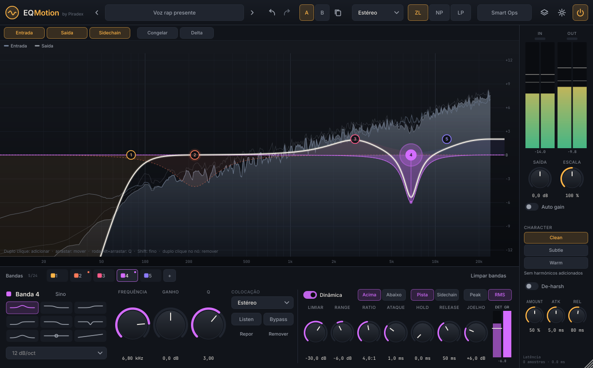

# EQMotion by Piradex

**Um equalizador dinâmico que mostra o que está a fazer.**
Versão **2.0.1** · VST3, Audio Unit e AAX para macOS (10.13+, Intel e Apple Silicon — corre num MacBook Pro 2013 com Catalina) e VST3 + AAX para Windows 10/11 64 bits · interface em **Português e Inglês**.



## O que tem

| Área | Funções |
|---|---|
| **Curva** | Até 24 bandas · 9 formas: sino, low/high shelf, low/high cut, notch, passa-banda, all-pass, tilt · cortes de 6 a 96 dB/oct + Brickwall · duplo clique para criar, arrastar, roda para o Q, duplo clique no nó para apagar · analisador ao vivo por baixo |
| **Dinâmica** | Qualquer sino/shelf/tilt passa a dinâmico · limiar, range (com sinal), ratio, ataque, hold, release, joelho · acima/abaixo (comprimir/expandir) · detetor da pista ou sidechain · Peak/RMS · lookahead global · halo e ponto "ao vivo" no gráfico + medidor no painel |
| **Smart Ops** | Deresonate, De-ess, Auto cortes, Igualar referência (sidechain ou outra instância), Unmask, Equilíbrio tonal · Aprender (≥ 2 s) → Rever (tracejado no gráfico) → Aplicar · Amount em tempo real · Aplicar e Reverter são um passo de desfazer cada; Reverter só remove as bandas da operação |
| **Comparar** | A/B com cópia · desfazer/refazer · Auto gain (comparações à mesma loudness) · Delta (só o que o EQ muda, alinhado em latência) · Listen e Bypass por banda |
| **Fase e estéreo** | Zero Latency · Natural Phase (igual ao analógico até 20 kHz) · Linear Phase (3 qualidades) · Estéreo, Esq./Dir., Mid/Side · colocação por banda: estéreo, L, R, M ou S |
| **Character** | Clean (sem harmónicos, nulo exato) · Subtle · Warm · De-harsh dinâmico |
| **Instâncias e presets** | Todas as instâncias do projeto num painel, com curvas e espetros sobrepostos · 46 presets de fábrica em 10 pastas · presets do utilizador com pesquisa e favoritos |
| **Idioma** | Seletor **PT \| EN** em *Definições › Idioma* e no ecrã de senha · troca imediata · primeira abertura segue o idioma do sistema · escolha comum a todos os plugins Piradex · nomes dos presets de fábrica traduzidos (o nome guardado na sessão não muda) · nomes de automação no DAW fixos |
| **Acesso** | Ecrã de senha igual aos outros plugins Piradex (senha master + senhas beta com validade, "lembrar neste computador"). Sem sessão o plugin deixa passar o áudio sem processar. |

## Downloads

Cada push compila e valida no GitHub Actions (auval Intel + Apple Silicon, pluginval, testes de áudio) e publica a versão **EQMotion by Piradex 2.0.1** na página *Releases* (no repositório do ANALYSER: `eqmotion-v2.0.1`):

* `EQMotion-by-Piradex-<versão>-macOS.dmg` — instalador `.pkg` + plugins para instalação manual
* `EQMotion-by-Piradex-<versão>-Windows-Setup.exe` — instalador (ou o `.zip` para copiar à mão)
* `EQMotion-by-Piradex-<versão>-macOS-AAX-*.zip` e `...-Windows-AAX-*.zip` — Pro Tools. O Pro Tools normal só carrega AAX assinados pela PACE: com os *Secrets* `PACE_ACCOUNT`, `PACE_PASSWORD`, `PACE_WCGUID`, `PACE_EDEN_URL`, `PACE_EDEN_WIN_URL`, `PACE_KEYFILE_B64`, `PACE_KEYPASSWORD` o CI assina sozinho (`...-AAX-assinado.zip`); sem eles sai `...-AAX-nao-assinado.zip` (só *Pro Tools Developer*).

## Compilar localmente

```bash
cmake -B build -DCMAKE_BUILD_TYPE=Release           # descarrega o JUCE 8.0.15
cmake --build build --config Release --target EQMotion_VST3 EQMotion_AU   # (AU só no Mac)
```

Testes:

```bash
g++ -O2 -std=c++17 -ISource tests/test_dsp.cpp -o test_dsp && ./test_dsp
g++ -O2 -std=c++17 -ISource tests/test_smartops.cpp -o test_smartops && ./test_smartops
cmake -B build -DEQM_BUILD_TESTS=ON && cmake --build build --target eqm_plugin_test && ./build/eqm_plugin_test
```

## Senhas

O código só contém o *hash* PBKDF2-HMAC-SHA256 (60 000 iterações) de cada senha. Para criar mais senhas beta:

```bash
python3 tools/nova_senha_beta.py 2027-03-31
```

e cole a linha gerada em `kKeys` (`Source/License.cpp`). O push volta a compilar tudo.

## Documentação

* [Manual](docs/MANUAL.md)
* [Arquitetura, decisões de DSP e latência](docs/ARQUITETURA.md)
* [Validação e critérios de aceitação](docs/VALIDACAO.md)

---
Piradex · www.beatfreakstudio.com · suporte: juninhopiradex@hotmail.com
