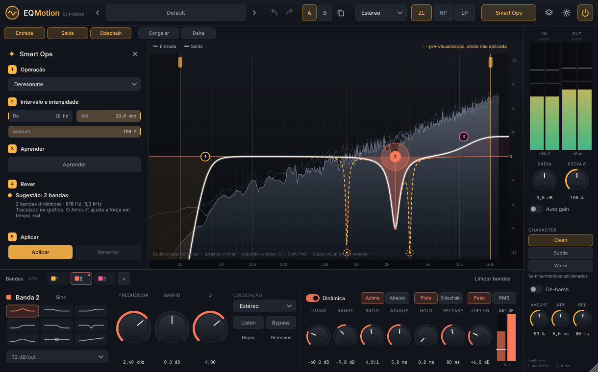

# EQMotion by Piradex — manual

## Primeira vez

Ao abrir o plugin aparece o ecrã de senha (igual aos outros plugins Piradex). Escreva a senha e carregue em **Entrar**; com **Lembrar neste computador** ligado não volta a ser pedida. Sem sessão iniciada o EQMotion deixa passar o áudio sem processar, com a mesma latência — nunca altera uma mistura sem querer. Para terminar a sessão: ⚙ → **Terminar sessão**.

## Barra de cima

| Controlo | O que faz |
|---|---|
| ‹ **Preset** › | Abre o navegador (pesquisa, pastas, ★ favoritos, **Guardar como…**). As setas passam ao preset anterior/seguinte. Um `*` indica alterações. |
| ↶ ↷ | Desfazer / refazer (também Cmd/Ctrl+Z e Cmd/Ctrl+Shift+Z). |
| **A B** ⧉ | Duas definições completas; ⧉ copia a atual para a outra. Cada uma tem o seu histórico. |
| **Estéreo / Esq./Dir. / Mid/Side** | O analisador divide-se para condizer; as bandas novas nascem em Esquerda (L/R) ou Mid (M/S). |
| **ZL · NP · LP** | Zero Latency (0 amostras, para gravar/ao vivo) · Natural Phase (igual ao analógico até 20 kHz, poucas amostras) · Linear Phase (sem distorção de fase, com latência; qualidade nas definições). |
| **Smart Ops** | Abre a gaveta das operações inteligentes. |
| ◇ Instâncias | Dá nome a esta instância e sobrepõe no gráfico a curva e o espetro de outras instâncias do projeto. |
| ⚙ Definições | Analisador (precisão até 16384, velocidade, inclinação), escala do gráfico, tamanho da janela (100–200 %), qualidade da fase linear, lookahead, licença. |
| ⏻ | Ligar / bypass (alinhado em latência). |

Por baixo: **Entrada / Saída / Sidechain** escolhem os espetros mostrados, **Congelar** fixa o espetro, **Delta** deixa ouvir só o que o EQ muda.

## O gráfico

* **Duplo clique** num sítio vazio cria uma banda (sino; perto das pontas cria um corte).
* **Arrastar** um nó muda frequência e ganho (nos cortes, arrastar na vertical muda a ressonância). **Shift** = ajuste fino.
* **Roda do rato** sobre um nó ou **Alt + arrastar** muda o Q.
* **Duplo clique num nó** apaga a banda. **Shift + clique** seleciona várias (arrastam juntas).
* **Botão direito** num nó: tipo, inclinação, colocação, dinâmica, Listen, bypass, copiar/colar, repor, remover. Num sítio vazio: colar, escala do gráfico, repor zoom, limpar tudo.
* **Cmd/Ctrl + roda** faz zoom horizontal; com zoom, **arrastar o fundo** desloca. Com zoom grande aparecem os nomes das notas. O cursor mostra Hz, nota e dB.
* Teclado: ← → frequência (Shift: fino), ↑ ↓ ganho, Tab muda de banda, Delete apaga, Cmd/Ctrl+C/V copia/cola (também entre instâncias).

Cores: cada banda tem a sua cor e número. Com bandas Mid/Side aparecem duas curvas (**M** âmbar, **S** azul); com bandas L/R aparecem **L** e **R**.

### Bandas dinâmicas no gráfico
A área sombreada com contorno tracejado é tudo o que a dinâmica pode fazer (ganho estático → ganho + range). O halo à volta do nó cresce com a redução atual e o pequeno ponto ligado ao nó mostra o ganho neste instante.

## Painel da banda

* **Tipo** (9 formas) e **inclinação** dos cortes (6–96 dB/oct ou Brickwall).
* **Frequência / Ganho / Q** — duplo clique repõe; clique no valor para escrever; Cmd/Ctrl + arrastar = fino.
* **Colocação**: Estéreo, Esquerda, Direita, Mid ou Side.
* **Listen** ouve só a zona da banda; **Bypass** tira a banda sem a apagar; **Repor**; **Remover**.
* **Dinâmica** (sinos, shelves e tilt):
  * **Acima / Abaixo** — atua quando o detetor sobe acima (ou desce abaixo) do limiar.
  * **Range** com sinal: negativo corta, positivo realça. Assim há compressão e expansão para cima e para baixo.
  * **Pista / Sidechain** — o detetor ouve esta pista ou a entrada sidechain (o sinal principal nunca muda por isso).
  * **Peak / RMS**, **Limiar, Ratio, Ataque, Hold, Release, Joelho**.
  * O medidor **DET / GR** mostra o nível do detetor (com a linha do limiar) e a redução atual.

## Coluna da direita

Medidores de entrada e saída (pico, RMS, retenção; clique para limpar o CLIP), **Saída** (±24 dB), **Escala** (multiplica todos os ganhos, 0–200 %), **Auto gain**, **Character** (Clean / Subtle / Warm), **De-harsh** (Amount, ataque, release) e a latência atual.

## Smart Ops

1. **Operação**
   * *Deresonate* — ressonâncias estreitas e persistentes → bandas dinâmicas limitadas (Q 3–18, até −12 dB).
   * *De-ess* — sibilância na zona escolhida (por omissão 4–12 kHz) → 1 banda dinâmica.
   * *Auto cortes* — graves/agudos onde só há ruído de fundo; sub e ar musicais são protegidos.
   * *Igualar referência* — a referência entra pelo sidechain (ou escolha outra instância do EQMotion).
   * *Unmask* — com a voz (ou outro sinal) no sidechain, cria bandas dinâmicas que só abrem espaço quando ela toca.
   * *Equilíbrio tonal* — correções largas e suaves (±4 dB) para o equilíbrio médio de misturas.
2. **Intervalo e intensidade** — De/Até (também se arrastam as pegas no gráfico) e Amount. Mudam a sugestão em tempo real, sem voltar a aprender.
3. **Aprender** enquanto a música toca; **Parar** fica disponível a partir dos 2 s.
4. **Rever** — número de bandas, zonas problemáticas a sombreado e a curva proposta a **tracejado**. Nada mudou ainda no som.
5. **Aplicar** cria as bandas (um passo de desfazer). **Reverter** remove só as bandas dessa operação; as suas edições manuais ficam.

## Instâncias

Em ◇ dê um nome a esta instância (por omissão é o nome da pista, se o DAW o indicar) e ligue as outras que quer ver: a curva aparece tracejada e o espetro numa linha fina. As instâncias também servem de referência em *Igualar referência*.

## Dicas

* Para comparar com justiça ligue **Auto gain** e use A/B ou ⏻: a definição melhor ganha, não a mais alta.
* **Delta** + uma banda dinâmica é a forma mais rápida de ouvir se está a cortar demais.
* Para masterização: **LP** (qualidade Média/Alta) ou **NP**; para gravar ou tocar ao vivo: **ZL**.
* O lookahead (⚙) só existe em Natural Phase.
